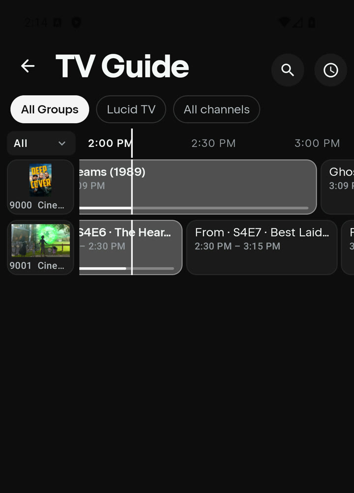
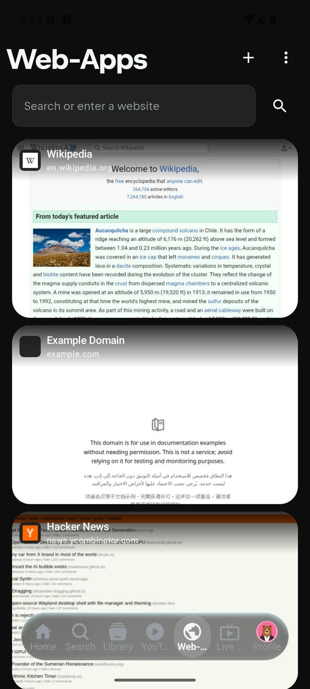
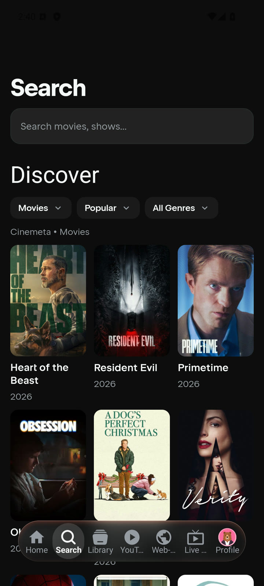
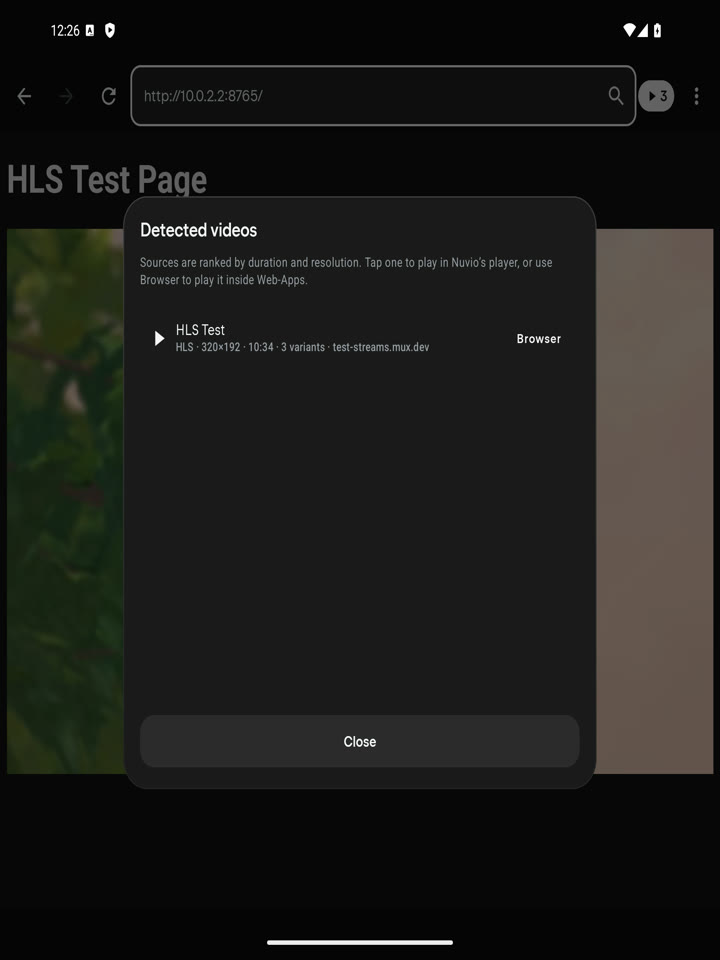
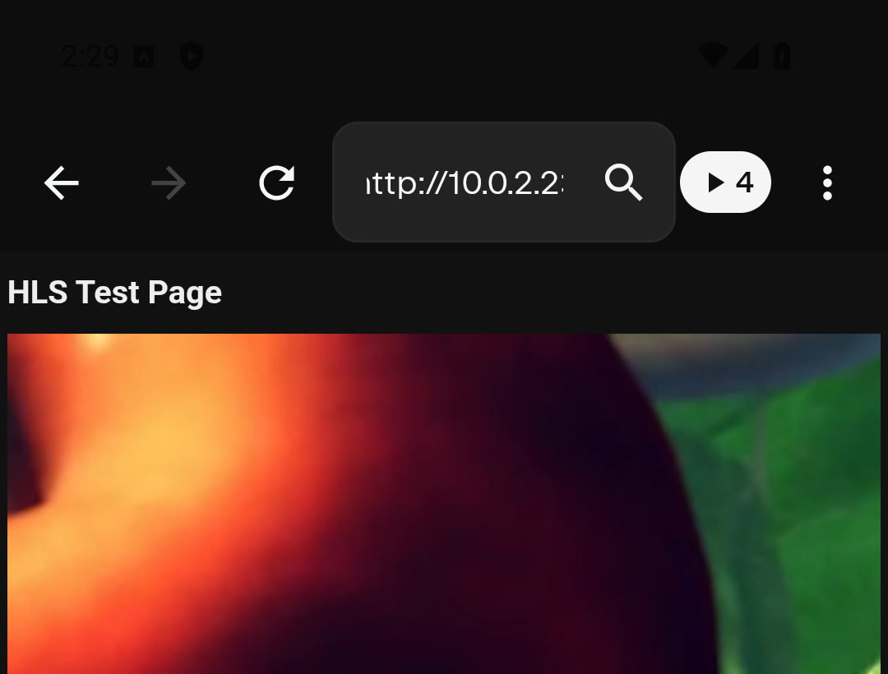

# Lucid Nuvio IPTV+ Mobile

**Live TV, Lucid TV, sports, movies, series, YouTube and a built-in web browser — in one Android app.**

[Install](#-install) · [Features](#-features) · [Screenshots](#-screenshots) · [Credits](#-credits) · [Legal](#-legal)

---

## 📱 Screenshots

| Live TV | Lucid TV | Web-Apps |
|:---:|:---:|:---:|
|  |  |  |
| **Discover** | **Sports** | **YouTube** |
|  |  |  |
| **Video detection** | **Browser playback** | **Player** |
|  |  |  |

---

## ✨ Features

### 📺 Live TV and DVR
- A full TV guide with channels, now/next programmes and a live time line.
- Multiple M3U playlists and XMLTV guides, merged into one guide.
- Xtream logins, including your provider's movies and series.
- Favourites, hidden groups, channel reordering and custom channel logos.
- Catch-up, reminders and recordings.
- Quick Channels for fast switching without leaving the player.
- Search that tolerates typos in channel names and On Demand titles.
- Top 10 and “Because you watched” rows on Home when a matching catalog is available.
- Catalogs marked as adult are hidden from Home by default.
- Channels access for every Live TV source, including catch-up and recordings.
- **Multi-view** for watching more than one channel at once.
- Parental controls for locked groups and adult content.

### 🎬 Lucid TV
- Add only the channels you want from any installed add-on catalog, series or playlist group — nothing is added to the guide automatically.
- Virtual channels built from add-on catalogs, series marathons, playlist relays and hand-picked collections.
- A Lucid TV studio for creating, editing, reordering and deleting channels, including a one-tap remove-all cleanup.
- Series catalogs expand into real episodes with titles, season/episode numbers and runtimes.
- Generated guide on each item's real runtime, so now/next and the stream stay on one clock.
- Join-in-progress playback, dead-item skipping and automatic advance when a film ends early.
- Smart pools: genre, year, rating, keyword filters, shuffle, release order and air order.
- Manual picks win when present; otherwise cached debrid → torrent P2P → direct HTTP.
- Cached winners, next-two prefetch and cached pools that repair automatically after upgrades.

### 🌐 Web-Apps and browser
- A Web-Apps tab for saved streaming sites, with wide browser-style cards.
- Each card starts with a site preview and is replaced by a real local screenshot after the first visit.
- Favicon, title and site URL over the top of each card.
- Add, edit and delete saved sites; sessions, cookies and settings persist.
- Android WebView with the stock user agent by default (Cloudflare-friendly) and an optional desktop mode.
- App navigation bar hides while browsing; the page keeps a bottom margin above the system navigation bar.
- **uBlock-style ad blocking:** hosts lists, curated uBO network rules and optional EasyList, EasyPrivacy and uBlock Origin filter lists.
- Media, top-level pages, Cloudflare challenge traffic, framework CDNs, the site's own scripts and XHR requests, and player frames are protected from broad filter rules.
- **Redirect and popup protection:** cross-site main-frame redirects and popups ask **Allow once / Always allow / Block always / Cancel** instead of silently breaking the page.
- Editable allow list for links and popups, plus per-site quick actions in the browser menu.
- Userscripts with Tampermonkey-style `@match` / `@include` / `@exclude` / `@run-at` and a GM_* shim.
- **Scan for videos** with a ranked detected-video picker, external-browser escape hatch and per-site adblock disable.
- **Play in Nuvio's player** with Referer, Origin, User-Agent, Cookie and custom `X-*`/`Authorization` headers.
- **Play in browser** for HLS through hls.js, direct files through a native video wrapper, and blob/MSE sources in the WebView.
- WebView renderer recovery: if Android kills the renderer, the browser rebuilds it instead of leaving a dead page.

### 🎞️ Movies, series and more
- On Demand with categories, search, sorting and quality tags.
- Stremio add-ons for catalogs, metadata and streams.
- Plugin repositories and external stream providers.
- Jellyfin and Emby media servers for browsing and playing your own library.
- Debrid: Real-Debrid, Premiumize and TorBox with cached checks, file selection and direct playback.
- P2P/torrent playback support and configurable stream selection.
- Trailers, Continue Watching, Library, watch progress and collections.
- Subtitles, audio tracks, playback speed, aspect ratio and next-episode autoplay.
- Offline downloads with pause/resume and process-death recovery.
- Provider filters for stream results, with quality and source badges.

### 🏆 Sports
- Scores, schedules and which of your channels are showing each game.
- Follow teams and leagues, with reminders and scoring alerts.
- A Replays tab with highlights and event videos.
- Pre-event and post-event videos on every game page.
- League tables and team cards.
- Live game cards with channels, scores and status.

### ▶️ YouTube
- Home, Subscriptions, History, Playlists, Channels, Live, Music, Gaming, News, Sports and Shorts.
- Search and play videos in the app's own player.
- Info, More Videos and Comments panels on the player.
- Last/Next video, Subscribe, Like/Dislike, Quality and Watch Later buttons, with playlists you create in the app.
- Resume playback, and progress reported to your YouTube account as well as kept on the device.
- Auto-play the next video when one finishes.
- YouTube videos in Continue Watching.

### 🎥 Player
- Media3/ExoPlayer playback for HLS, MP4, MKV and other common formats.
- Gesture controls, subtitles, audio tracks, playback speed, aspect ratio and stream info.
- In-app picture-in-picture and Multi-view.
- Chapter markers, a chapter list and a Titles on/off toggle.
- Skip intro, recap and outro segments; post-credits scenes are never skipped.
- Next-episode countdown with autoplay.
- Startup progress steps while a stream is loading.
- Sleep timer, backup streams, stream reload and playback diagnostics.
- External player handoff.

### 👥 Watch party
- Create or join a party with a short code.
- Up to three seats with host controls.
- Synced playback with member drift shown.
- Party chat with delivery status.
- Works with the regular player.

### 🔄 Tracking, sync and profiles
- Multiple profiles with their own library, progress and settings.
- Trakt, Simkl and MDBList integrations.
- Scrobble playback and sync watch progress, libraries and lists across devices.
- Optional Nuvio account (Nuvio Sync) for watch progress across devices.
- Episode release alerts for saved shows.
- Parental controls and PIN-locked profiles.

### 🎛️ Make it yours
- Themes, accent colours, poster customization and multiple Home layouts.
- Choose which Home rows appear and how Continue Watching looks.
- Playback settings for player, stream selection, up next, skip segments, audio, subtitles, video, buffer and P2P.
- Notification settings and per-profile add-on management.
- Built-in updater: check for and install new releases from **Settings → About**.

---

## 📦 Install

1. Open the [latest release](https://github.com/lucidconviction/lucid-nuvio-iptvplus-mobile/releases/latest).
2. Download the APK for your device:
   - **universal** — works on any device, largest download
   - **arm64-v8a** — most modern phones and tablets
   - **armeabi-v7a** — older 32-bit devices
   - **x86_64 / x86** — emulators and x86 devices
3. Open the downloaded APK and allow installs from your browser or file manager if Android asks.
4. Launch **Lucid Nuvio IPTV+ Mobile** and add your own playlist, provider or add-on.

**Requirements:** Android 7.0 or newer.

The app ships with no channels, playlists or media. You choose your own sources. It installs alongside the official Nuvio app and other Nuvio-based clients.

---

## 🔄 Updates

The app can check for new versions from inside **Settings → About** and install the matching APK from the latest GitHub release. You can also download any new release manually from the link above.

---

## ☕ Support this fork

If you enjoy the app, you can buy me some tea — completely optional and very appreciated.

---

## 🙏 Credits

This project builds on the work of:

- **[NuvioMedia / Nuvio Mobile](https://github.com/NuvioMedia/NuvioMobile)** — the upstream Nuvio client.
- **[Nuvio + IPTV](https://github.com/homelessbrian/NuvioPlusIPTV)** and **[Nuvio + IPTV Mobile](https://github.com/homelessbrian/NuvioPlusIPTV-Mobile)** — Live TV, Sports, On Demand and the IPTV foundations.
- **[Nuvio One](https://github.com/zoga2o3-ops/Nuvio-One)** — inspiration for bringing IPTV and YouTube together.
- **[ghbarker / NuvioMobile-IPTV](https://github.com/ghbarker/NuvioMobile-IPTV)** — the original IPTV port of Nuvio Mobile.

Thank you to every developer, tester and contributor in those projects. This fork is unofficial and is **not affiliated with or endorsed by NuvioMedia**. Please report issues with this fork here, not to the upstream teams.

---

## ⚖️ Legal

This app is a client-side player. It does not host, store or distribute any media, and it ships with no channels, playlists or content sources. Only use sources you own or are authorised to access.

Licensed under the **GNU General Public License v3.0**, like upstream Nuvio. See [LICENSE](LICENSE).
